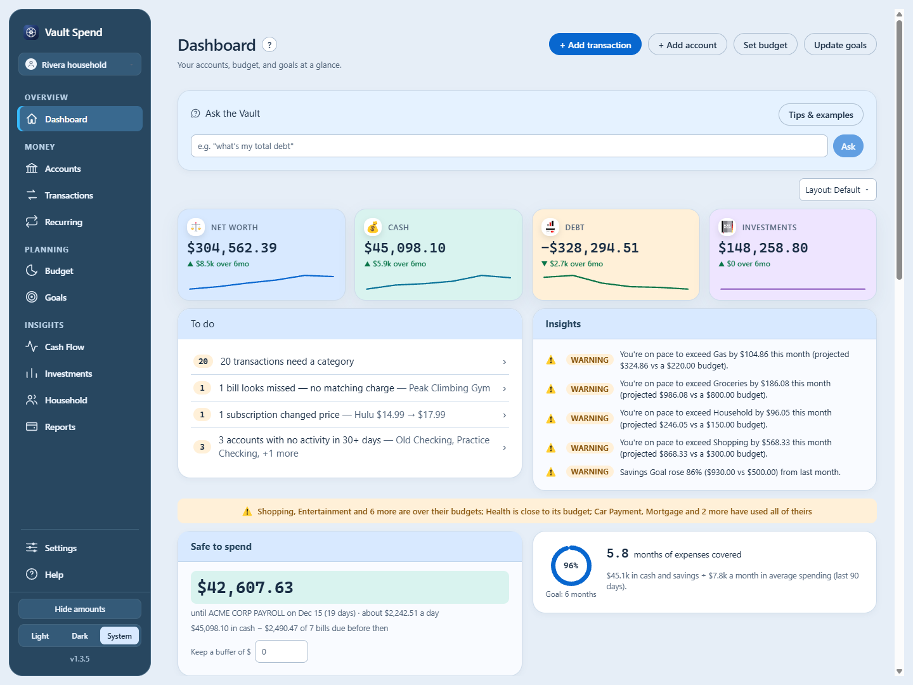
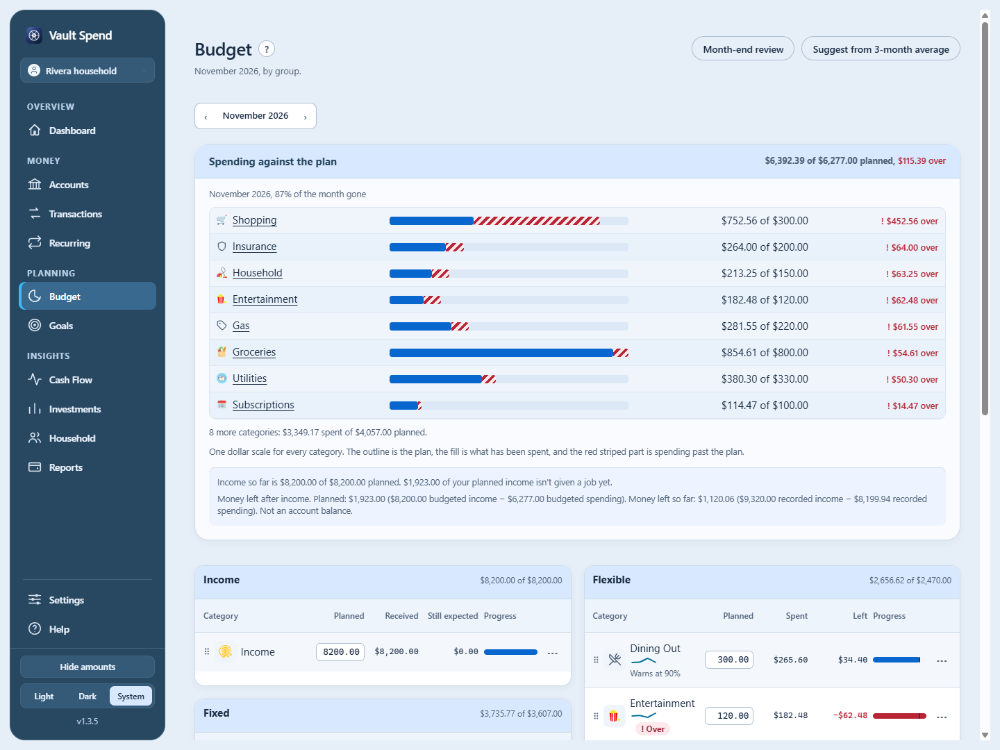
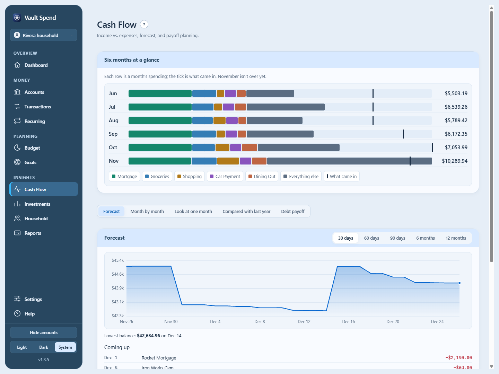

# Vault Spend

Vault Spend is a free, open-source desktop budgeting app for Windows and macOS. Track your spending, plan monthly budgets, and see what you own and owe. Your financial data lives on your computer. You can password-protect each profile, and there's no online account, cloud sync, or subscription.

**[Download Vault Spend for Windows or macOS](https://github.com/OneTrueAsian/vault-spend/releases/latest)**

Screenshots use fictional practice data.

## Get started

1. On the release page, open **Assets**. Run the `x64-setup.exe` installer on Windows. On macOS, open the `.dmg` and drag Vault Spend into Applications. Your computer may ask you to approve the installer or first launch.
2. Open Vault Spend and add an account. Enter transactions by hand or import a CSV, OFX, or QIF file from your bank.
3. Open **Budget** and set a spending target for your first category.

## What you can do

- Compare your spending with your monthly budget, track recurring bills, and save toward goals.
- See your net worth, forecast cash flow, plan debt payoff, and track investments.
- Use **Ask the Vault** to explore questions like “What if I cut Groceries by $50 a month?”
- Keep separate profiles and create automatic daily backups.

### Budget

### Cash Flow

## Optional phone access

Save a read-only snapshot in your phone's browser for offline viewing. To set it up, open **Settings → Mobile snapshots** on your computer. The app's Help walks you through pairing and explains what's saved on the phone.

## Learn more

Open **Help** in Vault Spend for walkthroughs and troubleshooting, or select the **?** beside a page title to jump to its guide.

[Privacy and legal notice](docs/LEGAL-NOTICE.md) · [Build from source](docs/BUILDING.md) · [Architecture](Architecture.md) · [Report a security issue](SECURITY.md)
